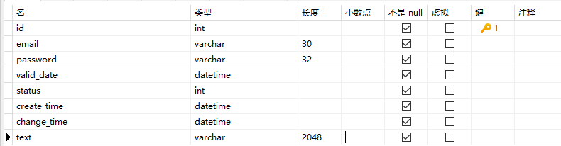
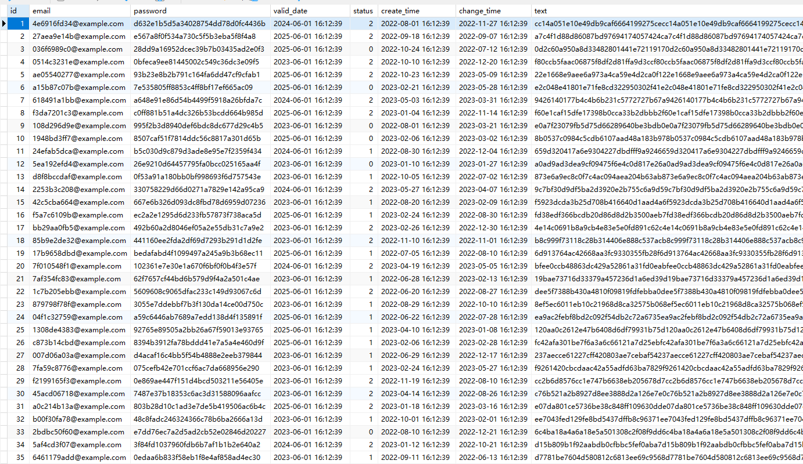
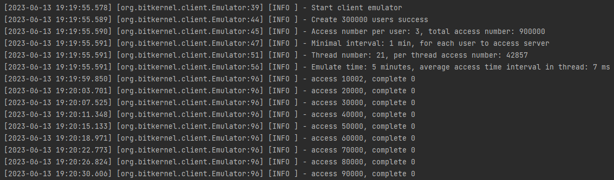

# 说明文档

## 工作流

1. 构建数据库记录条目 10M
2. 熟悉 BikCache 组件, 基于该组件实现用户登录服务
3. 实现客户端模拟器，300K 用户随机访问的程序，每个用户的访问间隔不小于 5 分钟
4. 部署主备模式数据库，主从模式 redis
5. 启动登录服务，根据不同的访问间隔多次进行验证
   - 验证 1：在系统启动 30 分钟后，关闭主数据库，检查系统服务情况
   - 验证 2：同时关闭主数据库及其可用区上的服务，检查系统服务情况
6. 将验证结果写成报告

## 构建数据库条目

首先创建 my_user_table, 包含字段 8 个字段，id、email、password、valid_data、status、create_time、change_time、text



通过在 mysql 编写函数实现随机构建条目内容

```sql
CREATE DEFINER=`root`@`localhost` FUNCTION `generate_user_data`(n INT) RETURNS int
    DETERMINISTIC
BEGIN
  DECLARE i INT DEFAULT 1;
  
  WHILE i <= n DO
    INSERT INTO my_user_table (email, password, valid_date, status, create_time, change_time, text)
    VALUES (
      CONCAT(
        LEFT(MD5(RAND()), 10),
        '@example.com'
      ),
      MD5(RAND()),
      DATE_ADD(NOW(), INTERVAL FLOOR(RAND() * 3) YEAR),
      FLOOR(RAND() * 3),
      DATE_ADD(NOW(), INTERVAL - FLOOR(RAND() * 365) DAY),
      DATE_ADD(NOW(), INTERVAL - FLOOR(RAND() * 365) DAY),
      REPEAT(MD5(RAND()), 32)
    );
  
    SET i = i + 1;
  END WHILE;
  
  RETURN i;
END
```

产生的条目内容如下所示



## BikCache 本地存储最大条目数量估算

AccountInfo 类占用字节大小估算

- 对象头：16 字节
- int 类型的 id：4 字节
- 固定 22 个字符的 String 类型的 email：16 + 4 + 22 = 44 字节
- 固定 32 个字符的 String 类型的 password：16 + 4 + 32 = 52 字节
- LocalDateTime 类型的 validDate：16 + 8 + 8 = 32 字节
- int 类型的 status：4 字节
- LocalDateTime 类型的 createTime：16 + 8 + 8 = 32 字节
- LocalDateTime 类型的 changeTime：16 + 8 + 8 = 32 字节
- 固定 1024 个字符的 String 类型的 text：16 + 1024 = 1040 字节
- 填充字节：2 字节

总共字节大小 = 1216 字节

BikCache 本地存储最大条目数量 = 500 * 1024 * 1024 / 1216 = 431157 条

由于 Map 本身也占用内存大小，因此我们设置 BikCache 的最大条目数量为 40*10000 条

## 客户端模拟器

可控参数：

- USER_NUMBER：用户数量
- ACCESS_PER_USER：每个用户访问的次数
- MIN_INTERVAL_IN_MINUTES：用户访问的最小间隔时间
- EMULATE_TIME_IN_MINUTES：模拟器模拟执行的总时间

程序会随着以上的参数自适应调整访问行为

大致逻辑：

- 生成用户
- 启动若干线程
- 计算每个线程需要执行的访问次数
- 计算每个线程执行一次访问需要间隔多少时间
- 计算每个线程执行一次访问需要
- 模拟访问



## 单机模式
